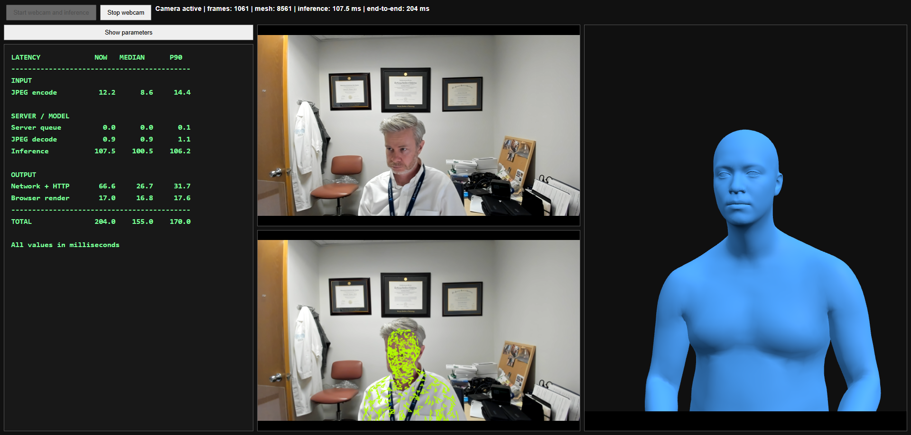

# Fast SAM 3D Body Webcam Demo

Live browser webcam inference using Fast SAM 3D Body on a remote NVIDIA GPU server.



## Overview

```text
Browser webcam
  -> JPEG frame over WebSocket
  -> Coder forwarded port
  -> persistent Fast SAM 3D Body estimator
  -> binary float32 mesh vertices
  -> projected overlay and interactive 3D rendering
```

The interface provides:

- Live webcam video
- Camera-aligned mesh overlay
- Independent interactive 3D mesh
- Runtime inference controls
- Current, median, and P90 latency measurements

## Upstream repository

This demo runs inside a working checkout of:

[Fast SAM 3D Body](https://github.com/yangtiming/Fast-SAM-3D-Body)

Project page:

[Fast SAM 3D Body project page](https://yangtiming.github.io/Fast-SAM-3D-Body-Page/)

## Requirements

The tested environment uses:

- Python 3.11
- PyTorch 2.5.1 with CUDA 12.4
- Detectron2 0.6
- MoGe2
- Ultralytics
- Flask
- flask-sock
- OpenCV
- NumPy
- NVIDIA RTX A6000

The Fast SAM 3D Body checkpoint must exist at:

```text
checkpoints/sam-3d-body-dinov3/model.ckpt
checkpoints/sam-3d-body-dinov3/assets/mhr_model.pt
```

The default pose detector is:

```text
checkpoints/yolo/yolo11m-pose.pt
```

The model repository is gated on Hugging Face. Access approval and Hugging Face authentication are required before downloading the checkpoint.

## Installation

**Local Windows demo (branch `local-anatomy`): see [INSTALL.md](INSTALL.md)** for the step-by-step set-up on a new PC, including
SKEL. The notes below are the original Linux/conda set-up.

Clone the upstream repository:

```bash
git clone https://github.com/yangtiming/Fast-SAM-3D-Body.git
cd Fast-SAM-3D-Body
```

Activate the Conda environment:

```bash
source "$HOME/miniconda3/etc/profile.d/conda.sh"
conda activate fast_sam_3d_body
```

Install the web dependencies into the active environment:

```bash
python -m pip install Flask flask-sock
```

Copy these files into the Fast SAM 3D Body repository root:

```text
webcam_server.py
webcam.html
```

## Model files

Authenticate to Hugging Face:

```bash
hf auth login
```

The required local directory should contain:

```text
checkpoints/
└── sam-3d-body-dinov3/
    ├── model.ckpt
    ├── model_config.yaml
    └── assets/
        └── mhr_model.pt
```

Download the YOLO11m-Pose detector if necessary:

```bash
python -c "from ultralytics import YOLO; YOLO('checkpoints/yolo/yolo11m-pose.pt')"
```

## EGL requirement

Headless rendering imports require the generic EGL loader.

On Ubuntu 24.04:

```bash
sudo apt-get install --reinstall libegl1
```

Verify EGL:

```bash
ldconfig -p 2>/dev/null | grep -E 'libEGL(\.so|_nvidia)'
```

Expected libraries include:

```text
libEGL.so.1
libEGL_nvidia.so.0
```

## Start the server

Activate the environment:

```bash
source "$HOME/miniconda3/etc/profile.d/conda.sh"
conda activate fast_sam_3d_body
```

Start the persistent inference server:

```bash
OMP_NUM_THREADS=8 \
MKL_NUM_THREADS=8 \
CUDA_VISIBLE_DEVICES=0 \
TRITON_PTXAS_PATH="$CONDA_PREFIX/bin/ptxas" \
FOV_MODEL=s \
FOV_LEVEL=0 \
FOV_SIZE=512 \
FOV_FAST=1 \
FOV_TRT=0 \
USE_COMPILE=1 \
USE_COMPILE_BACKBONE=1 \
DECODER_COMPILE=1 \
COMPILE_MODE=reduce-overhead \
COMPILE_WARMUP_BATCH_SIZES=1 \
MHR_USE_CUDA_GRAPH=0 \
GPU_HAND_PREP=1 \
SKIP_KEYPOINT_PROMPT=1 \
KEYPOINT_PROMPT_INTERM_INTERVAL=999 \
BODY_INTERM_PRED_LAYERS=0,1,2 \
HAND_INTERM_PRED_LAYERS=0,1 \
MHR_NO_CORRECTIVES=1 \
python webcam_server.py
```

Wait for:

```text
ESTIMATOR_READY vertices=18439 faces=36874
```

The first use of a new compiled inference path may be much slower than steady-state execution.

## Triton and CUDA

The tested host exposed CUDA 13.2, while the Conda environment contained CUDA 12.4 and Triton 3.1.0.

The following setting forces Triton to use the compatible Conda CUDA assembler:

```bash
TRITON_PTXAS_PATH="$CONDA_PREFIX/bin/ptxas"
```

Verify the selected assembler:

```bash
TRITON_PTXAS_PATH="$CONDA_PREFIX/bin/ptxas" \
python -c "from triton.backends.nvidia.compiler import _path_to_binary; print(_path_to_binary('ptxas'))"
```

Expected result:

```text
(<conda-environment>/bin/ptxas, 12.4)
```

## Coder port forwarding

The server listens on:

```text
0.0.0.0:8097
```

Configure Coder to forward server port `8097`.

The tested local browser address was:

```text
http://localhost:8098/
```

Open the page, then select **Start webcam and inference**.

## Video file instead of the webcam

**Use a video file** plays a local file (anything the browser can decode, for example MP4/H.264 or WebM) in place of the camera, looped
and muted. Nothing is uploaded as a file: frames are grabbed from the player and sent through the same WebSocket as webcam frames. The
file plays at its own speed and the estimator takes the frame showing when the previous mesh returns, so at about 9 meshes a second most
frames of a 30 fps clip are skipped. The focal length is recalibrated for each file.

## Runtime controls

### Inference mode

- **Body only:** lowest latency
- **Full body + hands:** processes body and hand crops

The first use of each mode may trigger additional `torch.compile` work.

### Camera intrinsics

- **Fixed calibrated median:** calibrates focal length and reuses the median
- **Dynamic MoGe per frame:** estimates focal length for every frame

The tested calibration window is 30 valid frames.

### Independent 3D view

- **Lock 3D center:** frames the mesh once and avoids visible center jitter
- **Reset 3D camera:** recalculates the initial framing
- Mouse drag rotates the mesh
- Mouse wheel zooms the mesh

Locking the independent view does not smooth or modify the predicted vertices.

### Overlay controls

- Show or hide the projected overlay
- Select dense, medium, or sparse topology
- Adjust opacity
- Adjust line width

The overlay uses predicted camera translation and focal length to project the mesh into webcam coordinates.

## Latency HUD

The HUD displays non-overlapping latency components:

```text
JPEG encode
Server queue
JPEG decode
Inference
Network + HTTP
Browser render
TOTAL
```

Each component reports:

- Current value
- Rolling median
- Rolling P90

All values are milliseconds.

## Observed performance

Observed on an NVIDIA RTX A6000 after compilation and focal calibration:

```text
Body-only inference at 448 or 512 input: approximately 75-100 ms
End-to-end latency: approximately 140-170 ms
```

Full body plus hands was slower in the tested configuration.

Results vary with:

- GPU contention
- Subject count
- Inference mode
- Model input size
- Compilation state
- Browser workload
- Overlay density

These values are deployment observations, not guaranteed benchmarks.

## Architecture notes

- The estimator is loaded once and reused.
- Frames and meshes use a persistent WebSocket connection.
- JPEG frames are transferred as binary data.
- Mesh vertices are returned as little-endian float32 values.
- Mesh topology is transferred once.
- The browser updates an existing Three.js geometry buffer.
- The server does not reload the model for each frame.
- OpenMP and MKL are limited to eight threads to prevent CPU oversubscription.
- Fixed median intrinsics remove repeated MoGe execution.
- Body-only mode avoids the two additional hand crops used by full mode.
- The independent mesh can use a fixed center without temporal smoothing.

## Femto Bolt in the page: point cloud and depth fusion

With an Orbbec Femto Bolt attached, the 3-D view's gear menu has two options. Both need `pip install pyorbbecsdk2` (tested:
wrapper 2.1.3, Bolt firmware 1.1.3, Windows) and the camera on a USB 3 port; without the SDK or the camera each option says why
it is unavailable. The page asks for the Bolt's colour camera as its webcam when one is present.

**Depth point cloud.** The server opens the Bolt's depth stream only (the browser keeps the colour camera), turns frames into
points with the SDK's own filter (factory calibration, lens distortion included), moves them into the colour camera's frame
with the factory extrinsics, thins them to 30,000 and serves the latest at `GET /cloud` (`depth/cloud.py`). Each point is
coloured from the Bolt's own picture: it is projected into the colour camera with the factory intrinsics and takes the pixel it
lands on (points outside the picture, or any point when the webcam is another camera, are coloured by distance). The depth mode
is the binned 320 x 288 one and clouds are made at most 15 times a second: converting every 640 x 576 frame slowed inference
from about 120 to 210 ms, because the capture thread shares the interpreter with the model loop. Capture runs only while an
option is on.

**Mesh distance and size from depth** (`depth/live.py`). A body mesh estimated from one picture has an unknown overall scale:
making it s times bigger and s times farther from the camera leaves its outline where it was. The server measures that one
number against the depth (robust median of measured depth over mesh depth, over the vertices the camera can see), filters it,
and the page scales the mesh about the camera by it; the shift readouts are scaled with it. Pose and outline are untouched.
While this is on and the webcam is the Bolt, the model is also given the Bolt's factory intrinsics instead of a focal length
estimated from the picture. A fit worse than 60 mm rms is refused ("depth does not match the mesh") and the last good scale is
kept. It adds no measurable latency (129 ms round trip with it on or off).

- Checked: the scale is recovered to 1% on a synthetic body (`tests/test_cloud.py`), and the server path runs against the real
  camera's depth. **Not yet checked on a live person**: the fit quality and the scale value on a real body, and whether the
  cloud's colours line up with the picture.
- Depth frame and picture are not time-matched: the newest depth is used. The scale changes slowly and is filtered, so this
  matters little for it; it would matter for a per-frame pose refinement, which is not done here.

## Femto Bolt depth fusion with ICP (experimental, older, not used by the page)

The RGB-only mesh has an ambiguous overall scale/depth (`pred_cam_t`). An Orbbec Femto Bolt
supplies metric depth, so the server can fix that ambiguity and refine the pose of the mesh.

```text
Femto Bolt RGB + depth (same device: factory extrinsics, hardware sync)
  -> SAM 3D Body on the Bolt's RGB            (pose + shape, slow path)
  -> depth anchor: one robust scale about the camera origin   (< 1 ms)
  -> projective point-to-plane ICP, 2-4 iterations            (a few ms, numpy)
  -> metric mesh + fit RMS + valid-depth fraction in the WebSocket JSON ("depth")
```

Why this design (from an architecture review):

- **Scale about the camera origin** leaves every pixel of the 2-D overlay unchanged, so the
  anchor fixes metric depth without fighting the RGB model. The scale is EMA-filtered because a
  body does not change size.
- **Projective ICP** (KinectFusion-style, no KD-tree) uses the depth image for correspondences,
  Huber weights, front-facing visible vertices only, and an optional `cloth_mm` correction for
  gowns/blankets. A hinge-style "one-sided" loss was rejected: it cannot see motion toward the camera.
- **Do not** snap vertices to the cloud (bakes ToF noise into the mesh), stream the cloud to the
  browser, or rely on Azure-Kinect body-tracking joints (redundant, weak supine/under a gown).
- For radiation-oncology style 6DOF, depth-to-reference-surface registration (`roi_icp_cloud`) is
  the measurement to report; SAM 3D vertex jitter is centimetre-level.

Files: `depth/synth.py` (software depth renderer, the test oracle), `depth/anchor.py`,
`depth/icp.py`, `depth/preprocess.py` (flying pixels, erosion, couch-plane removal),
`depth/fusion.py`, `depth/source.py` (`FemtoBoltSource`, `RecordedSource`, `SyntheticSource`).

```bash
python webcam_server.py --depth femto --cloth-mm 0          # live Femto Bolt
python webcam_server.py --depth recorded:session.npz        # npz: depth (T,H,W) uint16 mm, K (3,3), ts_us (T,)
```

Verified (synthetic, `pytest tests/test_depth.py`): scale recovery, 6DOF recovery to a few mm with
noise, flying pixels and a couch plane, gown-offset compensation, end-to-end fusion.

**NOT verified, no hardware was available:**

- `FemtoBoltSource` (pyorbbecsdk names follow the v1.x examples; check your version).
  Use NFOV unbinned mode; the 1 MP wide mode has a lower frame rate. Check the mode/fps table.
- The SAM 3D Body to camera-frame convention in `depth.fusion.mhr_to_camera_mm(flip_yz=True)`
  mirrors the browser's `(t0, -t1, -t2)` placement. Confirm that fused overlay and depth agree.
- Time sync: fit depth frame *k* to RGB frame *k* using device timestamps; never "latest" depth.
- ToF failure modes to expect: flying pixels at silhouettes, multipath under the arms and in the
  couch concavity, invalid pixels on black hair/clothing, warm-up drift of a few mm over tens of minutes.

## Anatomy atlas (TotalSegmentator structures on the MHR mesh)

`atlas/atlas.json` + `atlas/atlas.bin` hold **114 TotalSegmentator v2 structures** (about 140k
triangles, 1.8 MB) already expressed in the MHR rest frame and bound to the MHR skin mesh. Switch it on in the
**Anatomy (atlas)** panel (webcam page) or **Anatomy** section (mobile page).

How it is built (`python -m anatomy.atlas_build <subject_dir> mhr_rest.npz atlas/atlas`):

1. Ground-truth 117-class masks of one subject of the public TotalSegmentator dataset
   (v2.0.1, Zenodo 10047292, subject `s1159`, head to upper thigh). Your own CT segmented with
   TotalSegmentator works the same way.
2. Masks to meshes: marching cubes, Taubin smoothing, quadric decimation (budget by volume).
3. CT skin (threshold + opening, couch removed) registered to the MHR rest mesh: femoral/humeral
   head landmarks (RANSAC sphere fit) similarity, then three rounds of thin-plate-spline warps
   on torso + head skin. The warp moves **soft tissue only**. Bones are never warped: each bone takes just its
   *placement* from the warp (a rigid fit, scale fixed to the global similarity), so its shape stays true.
   (Warping bones inflated an L3 vertebra to 130 x 122 mm and squashed the skull to 97 mm deep; they are now
   89 x 70 mm and 196 x 148 x 130 mm.)
4. Limb bones are pose-normalised (the CT has the arms down, MHR is a T-pose): humeri and femora are
   swung about their joint centre onto the MHR limb axis.
5. **Containment**: the CT is supine and MHR is standing, so a skin-only warp leaves the spine and
   ribs touching the back (12.7% of vertices outside the skin, median rib/vertebra depth 6.5 mm).
   A smooth volumetric field then pushes every structure to a class-dependent minimum depth below
   the skin (0.0% outside afterwards for soft tissue; ribs >= 10 mm, spine >= 22 mm where possible; bones receive the field as a rigid shift only).
6. **Seating** (`seat_bone`): a bone cannot be bent into a smaller avatar, so the skull is seated by a small
   optimisation: rigid motion plus one uniform scale, minimising penetration of the skin below a 6 mm scalp margin,
   with priors on shift, rotation and scale (without them any placement deep in the torso also has zero
   penetration; the optimiser really did move the skull into the belly in testing). The skull ends 3.5% smaller and ~2 cm
   forward; shoulder girdle and pelvis get the same treatment without scaling.
7. The rig (`anatomy/rig.py`) is bound: nine rigid segments, a vertebra chain, rib and girdle
   attachments, and soft-tissue skinning weights.

### One skeleton-to-body fit (`tools/fit_skeleton_to_mhr.py`)

`atlas/ct_subject.*` is the atlas as built from the CT (the CT subject's own size and proportions). `atlas/atlas.*` is produced from
it by one tool, so the rest pose has a single definition instead of a fix-up per bone:

```bash
python tools/fit_skeleton_to_mhr.py atlas/ct_subject atlas/atlas mhr_rest.npz mhr_model.pt
```

1. **Trunk.** One in-plane scale for the thorax, the largest that still leaves the chosen soft tissue at the tightest level (x1.065
   side to side, x1.102 front to back), about the spine's posterior line, plus a 12 mm lateral shift that centres the rib cage. It is
   a smooth warp of space, so ribs, vertebrae, sternum, heart, lungs and vessels move together. It fades out through the neck and the
   abdomen; the pelvis keeps its size. Rib cage 262 x 184 mm -> 279 x 203 mm; tissue in front of it 41-75 mm -> 22-57 mm.
2. **Skull.** The atlas skull was vertically squat: its top was 53 mm under the scalp and its orbits 24 mm below the model's eye
   joints. It is fitted with rotation, translation and three scales so the vault lies a scalp thickness under the head skin and the
   orbits are at eye height (width x1.07, height x1.25, depth x1.06): top 8 mm under the scalp, orbits 2 mm from eye height, vault a
   median 7.4 mm deep, 0.5% outside. The neck follows the skull base. At run time the skull is carried by the skin that is rigid with
   the head joint (`atlas.json["mhr"]["cranium"]`: no neck, no jaw), not by C1 and not by the head patch that reaches into the neck.
3. **Joints.** Segments bound to MHR joints (`tools/bind_mhr_joints.py`).
4. **Arms.** Humeral head on the MHR shoulder joint, shaft on the shoulder-elbow line, girdle sized to meet it
   (`tools/seat_limbs_on_mhr.py`).

Assumed, not measured: the soft-tissue thicknesses in the tool (20 mm beside the ribs, 25 mm in front, 30 mm behind, 7 mm scalp). The
neutral MHR body has no anatomy inside it to check them against. Open questions the fit does not settle: whether the trunk skeleton
sits at the right height in this body (the MHR shoulder joints are level with C7, where a humeral head is normally 4-5 cm lower), the
hips (atlas hip centres are 24-26 mm from the MHR hip joints), and the clavicle, which has to be 36-41% longer than the CT subject's
to reach the MHR shoulder. A skeleton model with learned anatomy for this body (SKEL fitted through MHR-to-SMPL) is the reference that
would settle them. `tools/reseat_bones.py` is no longer part of the pipeline; its helpers are still used.

### Containment at rest and head size (superseded by the fit above; kept for the measurements)

The first live run showed arm and shoulder bones outside the body. The cause was in the atlas, not in the motion: against the neutral
MHR rest skin the humeri were 90% outside (up to 10 cm), the clavicles 40-58%, the scapulae 15-20% and the skull 7%; ribs, spine and
pelvis were inside. A bone that starts outside stays outside in every pose, because the rig only copies skin motion onto it.

- `python tools/reseat_bones.py atlas/atlas mhr_rest.npz` re-seats them: clavicle about the sternoclavicular centre, scapula about the
  acromioclavicular centre (kept at its rest gap from the rib cage), humerus about the glenohumeral centre, skull about the
  atlanto-occipital centre with a size change. Joints stay pinned and bones stay rigid. After it, all six shoulder bones are 0% outside
  the rest skin and the skull 0.3%. `mhr_rest.npz` (verts, faces) is the neutral MHR mesh; it is under the SAM License and is not in this repo.
- The skull (and brain) is now scaled at run time by the size of the live head patch relative to the rest patch
  (`Atlas.segment_scale`, `segmentScale` in `anatomy.js`), because the estimator predicts each person's own head size.
- Measured on one live webcam mesh: shoulder-group vertices outside the skin 52.5% -> 2.1%, skull 6.6% -> 3.3%.
- There is still no per-frame rule that tests bones against the live skin. Body shapes far from the neutral one (the live shoulders
  here were 12% wider) are only handled for the skull.

### Skeleton sized to the body, rotations from the MHR joints

The estimator predicts a different body for each person; the atlas skeleton is one size. On a slim subject (the Fast SAM 3D Body sample
image, torso about 0.75 of the neutral body) 21.6% of the spine surface, 24.8% of the rib cage and 13% of the pelvis lay outside the skin.

- **Body scale** (on by default, `body_scale` / `bodyScale`): every segment frame carries a uniform scale, the RMS size of the segment's
  live skin patch relative to its rest patch (clamped to 0.65-1.35). Vertebra spacing, ribs, sternum, girdle and soft tissue scale with
  the frame that carries them; joints stay pinned. On that image: spine 21.6% -> 4.3%, rib cage 24.8% -> 1.6%, pelvis 13.0% -> 1.0%,
  shoulder group 26.7% -> 9.0% (the humeri in a raised-arm pose are what is left).
- **MHR joints** (`tools/bind_mhr_joints.py`, `atlas.json["mhr"]`): the server now sends the 127 joint positions and rotations with each
  mesh. Each rig segment is bound to the joint that carries most of its skin patch's skinning weight (the limb's own joint where that is
  a twist helper). The segment takes its rotation from the joint; its position still comes from the skin patch. Anchoring positions to
  the joint centres instead was measured and was worse (rib cage 9.1% outside against 1.6%), so it is not used.
- Limb bones are scaled by joint-to-joint length (shoulder-elbow, hip-knee) when joints are present. The scale is uniform, so a long thin
  arm gets a bone that is slightly too thick.
- Measured by `tools/compare_drive.py` (bone surface outside the live skin, skin-driven against joint-driven).
- **Upper arm defined on the model's skeleton** (`tools/seat_limbs_on_mhr.py`, `atlas.json["mhr"]["limb_seated"]`): the atlas humeri
  pivoted 63-88 mm from the MHR shoulder joint and their shafts were 11-18 degrees off the MHR shoulder-elbow line, so they could not
  overlay the arm. At rest the humeral head is now on the MHR shoulder joint and the shaft on the shoulder-elbow line (length scaled to
  the joint distance); the scapula's glenoid is on the same joint and the clavicle is lengthened to meet the scapula, because the CT
  subject's girdle was narrower than the neutral MHR body (scapula x1.11-1.17, clavicle x1.34-1.52). At run time, with joints, the
  humeral head rides the live shoulder joint, the scapula is pinned there and the clavicle reaches from the sternum to the scapula.
  On the sample image: head 0 mm from the joint, shaft 0.0 degrees off the arm line, shoulder group outside the skin 9.0% -> 3.5%.
- Not done: the femur still sits in the atlas acetabulum (24-26 mm from the MHR hip joint); forearm, lower-leg, hand and foot bones
  (the atlas has none); anisotropic scale; a per-frame collision test.

### DRR X-ray inset and its reference

The DRR inset (`anatomy/xray.js`) and the label CT slice are drawn in camera space: the picture centre is fixed when the first mesh
arrives and each frame is placed with `pred_cam_t`, like the 3-D view. (They used to be drawn in the mesh's body-centred frame, whose
origin moves with the estimated pose, so a shrug dropped the skull in the picture although the head was still.) **Capture reference**
also stores the DRR of that moment; it is then shown in green under the live DRR in magenta, so agreement is grey and a shift shows
as a green edge where the bone was and a magenta edge where it is. **Reset 3D camera** re-centres the insets and drops that reference.

### SKEL: learned skeleton, missing limbs, jaw

SKEL (Keller et al. 2023) is a biomechanical skeleton inside an SMPL-topology skin, with bone sizes and positions learned from data.
It is under a non-commercial research licence: the model files and `atlas/skel.*` built from them are **not in this repository**
(`atlas/skel.*` is git-ignored). Without them the page falls back to the CT bones alone.

```bash
# SKEL models from https://skel.is.tue.mpg.de (login), unzipped to ../body_models/skel_models_v1.1
# ../body_models/mhr2smpl_mapping.npz from https://github.com/facebookresearch/MHR (tools/mhr_smpl_conversion/assets)
pip install git+https://github.com/MarilynKeller/SKEL --no-deps
python tools/fit_skel_to_mhr.py mhr_rest.npz ../body_models/mhr2smpl_mapping.npz ../body_models/skel_models_v1.1 ../body_models/skel_fit_mhr_rest.npz
python tools/build_skel_atlas.py ../body_models/skel_fit_mhr_rest.npz atlas/atlas mhr_model.pt mhr_rest.npz atlas/skel
python tools/fit_skeleton_to_mhr.py atlas/ct_subject atlas/atlas mhr_rest.npz mhr_model.pt --skel ../body_models/skel_fit_mhr_rest.npz
```

- **Fit.** SKEL is fitted to the neutral MHR body through Meta's MHR-to-SMPL vertex map, with no SMPL model file: skin-to-skin
  distance mean 13.2 mm (male model).
- **SKEL skeleton in the page** (`atlas/skel.*`, 36 bones). Trunk and head bones are rigid with the rig's skin-anchored segments
  (blended along the neck and the lumbar spine); limb bones use a new bind, `"mhr"`: rigid with a joint of the MHR skeleton
  (shoulder, elbow, wrist, hip, knee, ankle, toes), scaled by the joint-to-joint length. This adds what the CT atlas lacks:
  forearms, hands, femora, lower legs and feet.
- **Limbs defined on the body model's joints.** SKEL's own fit leaves the extremities outside the MHR skin at rest (feet 35-53%,
  toes 40%, hands 17-25%, ulnae 16-19%). Each long bone's SKEL joint segment (hip-knee, elbow-wrist, ...) is mapped onto the matching
  MHR joint segment; the hand is split into its 27 bones and every metacarpal and phalanx is seated on its own MHR finger segment, so
  fingers articulate with the mesh's fingers; the foot is fitted under the foot skin and its bones go with the MHR foot joint that
  carries the skin next to them. After seating: hands 1-3% outside, feet 0%, ulnae 2%, tibiae 6-7%.
- **Limb bone size.** Length along the bone follows the joint-to-joint distance; thickness follows the limb's girth, measured on a
  sample of the limb's skin (`girth_idx`). On the slim sample image this took the ulna from 32% to 12% outside; femur (14%) and tibia
  (19%) are still poor in that pose.
- **Skull in the DRR.** SKEL's skull is one closed surface with no cranial cavity, so the radiograph treats it as a 6.5 mm shell
  (`shell_mm`) instead of integrating through it.
- **Skeleton switch** (Anatomy panel): *SKEL* shows the whole learned skeleton; *CT atlas bones* shows only the CT bones (no forearms,
  hands, lower legs or feet). The two are never mixed. Both are posed by the same rig; the DRR follows the choice.
- **SKEL as the size reference for the CT fit** (`--skel`): the rib cage is sized to SKEL's in this body (265 x 183 mm) instead of
  from an assumed soft-tissue thickness: x1.011 side to side, x1.052 front to back. The CT rib cage was 262 mm wide to begin with,
  so the CT subject's thorax was already close to the right size for this body; mostly its centring changes.
- **Jaw.** The estimator does not move the jaw (its face parameters are switched off; the jaw joint rotates 0.00 degrees in real
  output), and the mandible cannot be separated from the CT skull mesh. The jaw shown is SKEL's, hinged about the line through its
  condyles, and its opening comes from a face tracker that runs in the browser on the same video (MediaPipe Face Landmarker,
  `jawOpen` blendshape, CPU; the library and its model are loaded from jsdelivr and Google storage on first use). 24 degrees at
  `jawOpen` = 1 is an assumed mapping, not a calibrated one.

### Layout

The panel under the video shows the imaging views (DRR X-ray and CT slice). Controls live in the picture they act on: each
view (DRR, CT, 3-D) has a gear in its corner that opens its options, and the controls used all the time sit in a strip along
the bottom of the picture (DRR: CT-to-bones blend; CT: PET and slice position). The left column holds only the reference panel,
with its regions and tolerances folded away. "Show parameters" and "Show latency" are in the top bar.

`run_local.cmd` starts the server on http://127.0.0.1:8097; run it in a terminal of your own so that it stays up.

### Reference CT

Each reference CT that has a rig built is a folder `atlas/subjects/<id>/` holding `atlas.*`, `skel.*`, `ct_volume.*` and
`ct_pet.*` (build into that folder; only `atlas.*` is in git). The page lists them in the CT gear menu ("Reference CT") and
loads the chosen one (`?ct=<id>`); with no subject folders it uses the files in `atlas/`. Two are built: `e0279` (ENHANCE.PET
0279, measured PET, the default) and `s1159` (TotalSegmentator, simulated PET).

### Real CT, deformed live (`tools/build_ct_volume.py`, `anatomy/ctvol.js`)

The page can show the atlas subject's real CT, carried by the rig: as a slice, and as a DRR ray-marched through the voxels. The CT
and the volumes built from it are not in this repository (`atlas/ct_volume.*`, `atlas/ct_pet.*` are git-ignored); without them the
page shows the label slice and the surface DRR.

The subject is a real PET-CT: study 0279 of ENHANCE.PET (AWS Open Data bucket `enhance-pet-1-6k`; this study comes from the
autoPET collection, CC BY-NC 4.0). Head to toe, both arms down and complete, 87-year-old man, melanoma work-up. The dataset ships
CT, PET and CT-derived labels per study, so no segmentation model is run. It was chosen by reading the NIfTI headers of all CTs
(length) and the bone labels of the 127 scans longer than 1.7 m (arm position).

```bash
# files of one study, from https://enhance-pet-1-6k.s3.amazonaws.com/imaging-data/ : images/CT, images/PT and the six
# ground-truth label volumes Cardiac, Muscles, Organs, Peripheral-Bones, Ribs, Vertebrae (0279.nii.gz each), saved under RAW/
python tools/enhance_subject.py RAW ../ct_data/e0279 --weight-kg 96 --dose-mbq 320 --uptake-min 60.35     # 1.5 mm grid, PET -> SUV
python tools/make_mhr_rest.py mhr_model.pt model.ckpt mhr_rest_kp.npz mhr_rest.npz                        # rest mesh + keypoints
python -m anatomy.atlas_build ../ct_data/e0279 mhr_rest_kp.npz atlas/ct_subject                           # atlas as in the CT
python tools/fit_skeleton_to_mhr.py atlas/ct_subject atlas/fitted mhr_rest.npz mhr_model.pt --skel ../body_models/skel_fit_mhr_rest.npz
python tools/build_ct_volume.py ../ct_data/e0279 atlas/ct_subject atlas/ct_volume --fitted atlas/fitted --skel atlas/skel        --align-atlas atlas/atlas --pet-out atlas/ct_pet --pet ../ct_data/e0279/suv.nii.gz
python tools/bind_mhr_joints.py atlas/atlas mhr_model.pt   # the aligned atlas needs its joint binding again
python tools/seat_limbs_on_mhr.py atlas/atlas mhr_rest.npz # the CT's arm and shoulder bones onto the model's joints
```

The earlier subject (TotalSegmentator s1159, no PET) still builds the same way from `tools/fetch_ts_subject.py`; its atlas is in
the git history.

- **Girth.** This patient's rib cage is 13% wider and 15% deeper than the neutral body model's. The trunk is scaled transversely
  about the spine's centre line by the ratio to the rib cage of the body-fitted atlas (lateral x0.88, front-to-back x0.85),
  tapering to none at the pelvis and neck. Heights are untouched. This is a shape change: transverse sections of the trunk,
  vertebrae included, are squeezed by those factors. Ribs outside the skin: 13% before, 0.8% after.
- **Head.** Sized from the skull's width against SKEL's skull and scaled about the top of the head (this label set's "skull"
  reaches further down the face than TotalSegmentator's, which misled a size taken from the whole label).
- **Not yet fitted.** Skull 16% outside the neutral head (the face), femurs 13% (the hips are not re-seated). The scan includes
  the legs and forearms, but the live CT still ends at the hips and the limbs below the elbow and knee have no CT atlas bones.
- **Offline, once per CT.** Meshes regenerated from the CT segmentations have the same vertex order as the atlas as built from the
  CT (`atlas/ct_subject.*`), so every atlas vertex has a known place in the CT (all 114 structures pair). The CT is un-posed with
  the rig's own model: one similarity per spine-chain frame (pelvis, each vertebra, head), fitted to that bone's pairs and blended
  by height exactly as the rig skins soft tissue. The trunk keeps the CT's own size (scale 0.987); the head is placed, with one
  uniform scale, onto the skull of the atlas fitted to the body model (`atlas/fitted.*`), so the neck bends to bring the scan's
  head into the model's head. The CT is resampled through that map on a 2 mm rest-frame grid as half-float HU, couch removed.
- **Registered onto the SKEL spine (`--skel`).** The scan's own spinal curve (supine, pillow) is not the body model's: against
  SKEL fitted to the same body, T1 was 40 mm forward, L5 44 mm back, the pelvis 41 mm back. With `--skel` each vertebra's target
  is moved onto SKEL's vertebra (SKEL's thoracic vertebrae are the twelve midline pieces of its thorax mesh), the pelvis onto
  SKEL's pelvis and the skull onto SKEL's skull, before the chain frames are fitted. This is an articulated registration driven
  by the spine: every vertebra moves rigidly and takes its tilt from its neighbours, soft tissue is interpolated between, and no
  bone is bent (a free-form deformable registration would bend them). After it the CT's vertebrae are a median 1.6 mm (worst
  7.5 mm) from SKEL's, so the CT voxels and the SKEL skeleton can be blended in one DRR.
- **The CT atlas is the CT.** `--align-atlas` rewrites `atlas/atlas.*` with every structure taken from the CT through the same
  map, so the CT slice, the CT-voxel DRR and the CT-bone overlay are one coherent CT. Against the neutral body model: rib cage and
  pelvis 0% outside the skin, spine 0.7%, skull 9.5%. The scan has the arms by the side, so its humeri, scapulae and clavicles
  are then seated on the model's shoulder and elbow joints (`tools/seat_limbs_on_mhr.py`: shoulder group 0.7% outside, was 44%),
  which is what lets the atlas bones articulate at the shoulder. They are still this CT's bones; SKEL is never mixed in.
- **Maps that were tried and dropped.** Following every vertex pair tore the image (the atlas build moved neighbouring structures
  differently). An affine per height level sheared it. A single similarity kept the CT intact but left the head where the scan's
  pillow put it, 39% outside the model's head.
- **Live.** The rig moves soft tissue with the two spine-chain frames bracketing its rest height. For each point the fragment
  shader solves `y = sum w_k(y) F_k^-1 p` for the rest point `y` by fixed-point iteration and samples the volume there. A scan
  that ends at the hips stays with the pelvis frame down to its end.
- **Slice.** By default a coronal plane of the rest body carried by the T8 frame, so it stays coronal when the person turns; it
  can be fixed to the camera instead. Window presets: soft tissue, bone, lung.
- **DRR.** One slider blends two radiographs that share a camera (so both can be dragged round). At one end, *CT voxels*: an
  orthographic ray per pixel marched through the deformed volume (each step warm-started from the previous one), brightness an attenuation line integral with bone weighted up, as at kV energies; the arms in it do not articulate. At
  the other end, *bones*: the surface DRR, fully articulated (shoulders, arms). "DRR bones" chooses which bones: the skeleton
  shown in the 3-D view (SKEL or CT atlas) or always the CT atlas bones. At 0% or 100% only one of the two is drawn.
- **Reference.** "Capture reference" keeps the current slice and DRR; they are then drawn in green under the live picture in
  magenta. A reference only means something in a camera-fixed picture, so the slice switches to the camera plane while one is held.
- **PET.** A second volume in the same rest frame, fused in colour on the slice and as a maximum-intensity projection on the
  DRR (SUV window 0-7). It is this patient's measured PET, converted to SUV (body weight) from Bq/ml with the dose, weight and
  uptake time in the dataset's sheet, and carried through exactly the same map as the CT. Without `--pet`, `--pet-out` writes a
  simulated uptake map from the segmentation instead (typical FDG SUV per organ, no lesions), which the page labels as simulated.
- **Cost.** The voxel DRR is drawn at most 20 times a second (96 steps, 320 x 320): drawn on every animation frame it competed
  with the model for the GPU.
- **Limits.** It is the atlas subject's CT, not the person's. Bones follow the soft-tissue frames in these views, so the shoulder
  girdle and arms do not articulate. The scan ends at the hips. Skin and subcutaneous tissue are carried by the nearest frames.

### One person

The page shows one body. When the detector finds several people, the server keeps the one it was already following (largest
overlap with their box on the previous frame); with nobody followed yet it takes the largest box near the middle of the image
(`pick_person` in `webcam_server.py`). The detector wrapper returns no confidences, so size and position stand in for them.

### Label CT slice

`anatomy/ct.js` draws a slice of the posed atlas next to the DRR X-ray. It is a label image (one flat grey per tissue), not
CT: the atlas holds surfaces, not voxels. The slice plane is fixed to the camera and follows the thoracic spine front to back.
Scapulae and costal cartilage (open meshes) are missing from it, and a few meshes with small holes can leave thin streaks.

### Biomechanics (how the anatomy moves)

An earlier version fitted every structure rigidly to its own patch of skin. Neighbouring ribs,
vertebrae and organs then disagreed and the anatomy looked sheared. It is now a kinematic model
(`anatomy/runtime.py` is the reference, `anatomy/anatomy.js` the port; the two agree to float32 rounding):

- **Segments are rigid.** pelvis, lumbar, lower thorax, upper thorax, head, two upper arms, two thighs. Each gets a
  rest-to-live rigid transform (Horn / Kabsch) from a fixed patch of MHR skin vertices. The thorax patches are
  narrow so that armpit skin does not leak arm motion into the trunk.
- **Every bone is rigid.** Hip bones, sacrum, skull and limb bones follow their segment.
- **The spine is a kinematic chain.** Each vertebra's rotation is a quaternion blend of the segments at its height, so
  bending and axial twist are distributed over the vertebrae (swing, twist and bend all fall out of the
  rotation blend). Positions come from forward kinematics, so vertebra spacing is preserved. A smoothed skin-driven
  offset (sigma = 3 vertebrae) keeps the chain placed under the skin.
- **Ribs, sternum, cartilages, clavicles and scapulae ride on the vertebrae they articulate with** (rib k on T-k:
  the costovertebral joint stays exactly rigid).
- **Soft tissue** (organs, vessels, muscles, airway, brain) is skinned between the chain frames bracketing its
  height, so it deforms continuously; gluteal and psoas muscles blend onto the thigh below the hip.

**Validation** (`tests/validate_rig.py`, real MHR articulations from `mhr-body.onnx`, ~2500 sample points; the old
per-structure fit is rebuilt on the same geometry for a fair comparison):

| pose | points pushed outside the skin | change in vertebra/rib spacing (max) | adjacent-vertebra rotation (max) |
|---|---|---|---|
| spine bend / twist / mix | 0.1 - 0.3% (old: 0.0 - 0.2%) | 1.9 - 2.6 mm (old: 4.8 - 10.0 mm) | 8 - 10 deg (old: 8 - 19 deg) |
| neck and head | 0.1% | 2.0 mm (old: 8.1 mm) | 10.8 deg (old: 10.8 deg) |
| right arm raised | 5.2% (old: 5.0%) | 1.6 mm (old: **36.8 mm**) | 3.0 deg (old: **26.5 deg**) |
| whole-body rotation | 0.0% | 0.0 mm | 0.0 deg |

The old fit stayed inside the skin only because each structure chased its own skin patch; it did not keep a
coherent skeleton (vertebra spacing off by up to 37 mm, neighbouring vertebrae rotating 26 deg apart under a raised arm).
`pytest tests/` checks the rig on controlled segment motions: bones are exactly rigid (< 0.1 mm), a spine twist
distributes monotonically from pelvis to head, vertebra spacing is preserved to 4 mm, ribs keep their vertebra
exactly, and a whole-body rigid motion moves every structure, soft tissue included.

What the model does **not** do:

- No organ physics: no sliding, no breathing, no gravity, no contact. Soft tissue is skinned, not simulated.
- The thorax is rigid per segment. Real ribs flex a little, and the scapula slides over the ribcage.
- The arms: only the humerus (pose-normalised) and the proximal femur are in the atlas, so wrist/elbow/knee motion is not modelled.
- With the arm raised high, MHR's own neck skin collapses inward and cervical vertebrae C4-C6 end up outside the skin (5.2% of
  points). The old fit shows the same artefact: it comes from the MHR surface, not the rig.
- The rig only sees MHR skin motion. A deep motion that does not show on the skin (a rib cage expanding with breath, a
  pelvis tilting under soft tissue) is invisible to it.

### Joint connection rules

Bones that articulate are assembled as groups (head+neck, thorax, lumbar, pelvis), each placed with ONE rigid transform, so they
keep the CT subject's own joint geometry (a glenohumeral ball sits in its socket at rest). The joint table in `atlas.json`
holds, for every joint, a centre shared by a parent and a child bone. At runtime the child rotates about that centre and the
centre is pinned to the parent's image of it, so no motion can pull a ball out of its socket. Rotations are clamped to a
range of motion (isotropic cones, not anatomical envelopes: they only stop skin noise producing impossible poses).

| Joint | Parent -> child | Driven by |
|---|---|---|
| glenohumeral (ball) | scapula -> humerus | upper-arm skin rotation |
| acromioclavicular | clavicle -> scapula | a third of the arm's elevation (scapulohumeral rhythm) |
| sternoclavicular | sternum -> clavicle | clavicle aims its lateral end at the shoulder cap (shrug, protraction) |
| hip (ball) | hip bone -> femur | thigh skin rotation |
| atlanto-occipital | C1 -> skull | head skin rotation; the brain is rigid with the skull |
| costovertebral (x24) | vertebra -> rib | respiratory rotation about each rib's neck axis (`breath`, `depth`) |

Measured on real MHR poses (`tests/validate_joints.py`, gap between child and parent surfaces near the joint, mm):

| Joint | Gap at rest | Change under shoulder shrug | Before the joint rules |
|---|---|---|---|
| glenohumeral L / R | 1.3 / 1.8 | -0.4 / +0.2 | 28-37 mm gap at rest, ~30 mm more under shrug |
| hip L / R | 0.9 / 1.1 | 0.0 / 0.0 | |
| skull on C1 | 0.6 | 0.0 | |
| sternoclavicular L / R | 2.9 / 2.6 | +2.7 / +3.4 | |
| acromioclavicular L / R | 5.1 / 5.4 | -3.2 / -3.7 | |

Breathing (`atlas.pose(skin, breath, depth)`; `breath` 0 = end-expiration .. 1 = end-inspiration): ribs rotate about their
neck axes (default amplitudes in `anatomy/rig.py: RESP_DEG` are uncalibrated placeholders), the sternum and cartilages ride on
the ribs, and the clavicles follow the sternum. The soft-tissue (lung/diaphragm) response is not implemented yet.

### Limits that must stay visible

- **Not patient-specific, not for clinical use.** Internal positions are an atlas guess scaled to
  the skin. Expected localisation error is roughly 1-2 cm for bones near the skin and several cm
  for deep soft tissue (`UNCERTAINTY_MM` in `anatomy/classes.py` is a prior, not a measurement).
- The source CT stops at the upper thigh and has no arms: **no distal limbs**, and 3 of the 117
  classes are empty in this subject (`kidney_cyst_*`, `prostate`). Distal anatomy would need another
  source (for example BodyParts3D / Z-Anatomy, both CC BY-SA share-alike).
- One atlas subject, one body habitus. The build should be repeated for several subjects, and
  validated leave-one-out (warp subject A's atlas to subject B's skin; score Dice/ASSD per class).
- Arms: the CT arms are not in the MHR T-pose, so the registration is driven by torso and head only.
- TotalSegmentator **dataset** is CC BY 4.0: cite Wasserthal et al., *Radiology: Artificial
  Intelligence* 2023. The TotalSegmentator code is Apache-2.0, but some model subtasks are
  restricted for commercial use. MHR / SAM 3D Body / InstantHMR files are under the SAM License:
  read it before redistributing the atlas or the MHR rest mesh.

### Tests

```bash
pip install numpy scipy pytest scikit-image nibabel trimesh fast-simplification rtree
pytest tests/                                  # 28 tests: depth, rig invariants on the shipped atlas, JS-vs-numpy parity (needs node)
PYTHONPATH=. python tests/validate_rig.py atlas/atlas - mhr-body.onnx mhr_rest.npz   # real-MHR-pose comparison (needs the onnx file)
```

## Troubleshooting

### First inference times out

A new `torch.compile` graph may take substantially longer on first use. Increase the WebSocket inference timeout and retry after compilation completes.

### `Unable to load EGL library`

Reinstall the generic EGL loader:

```bash
sudo apt-get install --reinstall libegl1
```

### Triton reports an unsupported CUDA version

Force Triton to use the Conda CUDA 12.4 assembler:

```bash
export TRITON_PTXAS_PATH="$CONDA_PREFIX/bin/ptxas"
```

### `ModuleNotFoundError: flask_sock`

Install flask-sock with the active Conda Python:

```bash
python -m pip install flask-sock
```

### High or variable preprocessing latency

Confirm the thread limits are active:

```bash
export OMP_NUM_THREADS=8
export MKL_NUM_THREADS=8
```

The uncapped environment used 128 intra-op and 128 inter-op threads and produced substantially higher latency.

## Privacy

Webcam frames are transmitted to the configured GPU server for inference.

Before using identifiable, clinical, research, or otherwise sensitive video, confirm that the server, browser connection, storage behavior, and network path comply with applicable institutional privacy and data-handling requirements.
