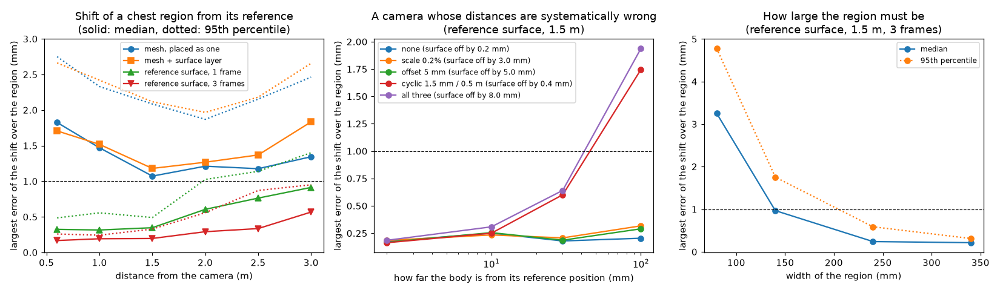

# Depth and pose for a clinical tool: a simulated study

**Question.** The RGB model's pose is good and its distance is wrong. The page corrects the distance with the depth camera. If
a region of interest has to be right to under a millimetre over the whole working range, what should the depth camera be
used for: one scale, a fit of the mesh, a pose detector of its own, or something simpler built on the known camera geometry?

**Answer in one paragraph.** Do not ask the body mesh to be the measurement. Measure the region the way surface-guided
radiotherapy does: keep the region's surface as the calibrated depth camera saw it at reference time, and register the live
depth of the same region onto it rigidly (six degrees of freedom). The mesh from the RGB model then has two jobs it is good at:
saying which pixels are the region, and giving the registration a first guess. In simulation this gives a median 0.2 mm
(95th percentile 0.3 mm) at 1.5 m and stays under 1 mm out to 3 m, where fitting the mesh gives 1.1-1.8 mm (95th percentile
2-2.7 mm) at every distance. No depth-based pose detector is needed: the result does not change when the model's pose is wrong
by 15 degrees or the region is found 40 mm from where it should be. What does need care is the camera: its distance errors,
the size of the region, and, with several cameras, how well their poses are known.

Everything below is simulated (`tools/depth_study.py`, results in `docs/depth_study.json`), so the truth is known exactly.
It has not been checked on a person or a phantom.

## What was simulated

- **Body.** The MHR neutral mesh. The person's true shape differs from the model's by a smooth field of 8 mm rms along the
  surface normal (build, clothing). The earlier recordings left 7 mm after a rigid fit, so this is about the size seen.
- **Depth camera.** Femto Bolt geometry (640 x 576, f = 505 px), whole-millimetre output. Random noise per pixel and frame
  1.0 + 0.17 z² mm (z in metres): this is what this project's own Bolt showed on the static background of its recordings
  (1.4-1.6 mm at 1.5-2 m, 2.3 mm at 2.5-3 m). Systematic errors are switched on in experiment 3 only.
- **RGB model.** The model's own shape, 15% too far away along every ray, its lean wrong by 3 degrees, and trembling from
  frame to frame (0.3% in distance, 1.5 mm sideways at 1.5 m, 0.4 degrees).
- **Region.** The front of the chest within 120 mm of the sternum (about 3000 depth pixels at 1.5 m), seen by a camera that
  looks 30 degrees down the body, so the region spans 80 mm of depth.
- **Motion.** The region moves rigidly by up to 5 mm and 1.5 degrees on each axis. Meanwhile the arms swing 6 degrees and the
  head turns 5 degrees, as people do.
- **Error reported.** The largest error of the estimated motion over the region's points (so a rotation error counts at its
  lever arm), median and 95th percentile over 12 trials.

The three ways of measuring the shift:

| | What is compared |
|---|---|
| mesh, placed as one | the model's mesh, placed by the depth (one scale, then a rigid fit of the whole body), at reference and now |
| mesh + surface layer | the same with the skin drawn onto the measured surface (what the page shows today) |
| reference surface | the live depth pixels of the region, registered point-to-plane onto the region's reference depth surface (reference averaged over 1 s; the mesh supplies the pixel mask and the first guess) |

## 1. Is one scale wrong across a range of depths?

Not for the reason it seems. A picture cannot tell size from distance, and that ambiguity is exactly one scale about the
camera: it moves every point along its own ray, in proportion to its distance. If size is the model's only error, one scale
is exact however much depth the body spans (under 0.2 mm with the body tilted anywhere from 0 to 60 degrees). What one scale cannot repair is the model being wrong about
the body's **relative** depth: how far it leans towards the camera, and its shape.

Error of the placed mesh against the true body, median over the visible region, 1.5 m:

| The model's error | one scale | scale + rigid fit | + surface layer |
|---|---|---|---|
| size only | 0.04 mm | 0.4 | 0.6 |
| + lean wrong by 5 degrees | 16.6 | 2.1 | 1.7 |
| + shape off by 8 mm | 15.2 | 8.4 | 6.3 |
| + arms wrong by 8 degrees | 26.2 | 7.0 | 3.8 |

With the lean 3 degrees wrong, one scale leaves 15-20 mm at the edge of a 340 mm region; the rigid fit brings that to about
2 mm. With the shape wrong as well, no placement of the mesh gets below several millimetres in 3-D, and the surface layer
only moves vertices along their rays: the skin lands on the measured surface, but a given vertex is not on the right piece of
skin. A fitted mesh is therefore not a sub-millimetre measurement of anatomy, whatever the fit.

## 2. The shift of a region from its reference, by distance

| Distance | mesh, placed as one | mesh + surface | reference surface, 1 frame | reference surface, 3 frames |
|---|---|---|---|---|
| 0.6 m | 1.8 (2.8) | 1.7 (2.7) | 0.32 (0.49) | 0.17 (0.26) |
| 1.0 m | 1.5 (2.3) | 1.5 (2.4) | 0.32 (0.56) | 0.19 (0.24) |
| 1.5 m | 1.1 (2.1) | 1.2 (2.1) | 0.35 (0.49) | 0.20 (0.33) |
| 2.0 m | 1.2 (1.9) | 1.3 (2.0) | 0.61 (1.03) | 0.29 (0.56) |
| 2.5 m | 1.2 (2.2) | 1.4 (2.2) | 0.76 (1.14) | 0.34 (0.87) |
| 3.0 m | 1.3 (2.5) | 1.8 (2.7) | 0.91 (1.40) | 0.57 (0.95) |

Median (95th percentile), mm. The mesh's error does not fall with distance or with more depth data, because it is not noise:
it is the model's own frame-to-frame trembling and the arms and head pulling a whole-body fit. The reference surface is
limited by noise only, so it improves with averaging (three frames cost 67 ms of latency at 30 frames a second) and with
more pixels. Registration took 10-30 ms a frame in this unoptimised form (a nearest-neighbour tree; a projective lookup, as
the page's fit already uses, would be a few milliseconds).

## 3. A camera whose distances are systematically wrong

| Camera error | Measured surface is off by | Shift error at 2 mm | 10 mm | 30 mm | 100 mm from the reference |
|---|---|---|---|---|---|
| none | 0.2 mm | 0.18 | 0.25 | 0.18 | 0.20 |
| distance scale 0.2% | 3.0 | 0.18 | 0.23 | 0.21 | 0.32 |
| constant offset 5 mm | 5.0 | 0.17 | 0.26 | 0.19 | 0.29 |
| cyclic 1.5 mm, period 0.5 m | 0.4 | 0.16 | 0.25 | 0.60 | 1.75 |
| all three | 8.0 | 0.19 | 0.31 | 0.64 | 1.94 |

An offset and a scale error put the surface millimetres from where it truly is and leave the shift from the reference
untouched: both captures carry the same error, and it cancels. A distance-dependent (cyclic) error does not cancel once the
body is far from its reference position. Two consequences:

- **Relative to a reference, sub-millimetre needs no absolute depth calibration**, provided the patient is within a few
  centimetres of the reference position. That is the monitoring case.
- **Absolute position does** (setting up to a plan, or a reference taken from the planning CT's skin). The camera's distance
  error then has to be mapped over the working volume with a target of known geometry at several distances, and the map
  applied to every frame. The calibration cube in the gantry recording is the start of this.

## 4. Does the region have to be found exactly? Is a depth-based pose needed?

No.

| Region found off by | 0 mm | 10 | 20 | 40 |
|---|---|---|---|---|
| shift error, median (95th) | 0.24 (0.59) | 0.22 (0.57) | 0.20 (0.50) | 0.18 (0.36) |

| Model's lean and arms wrong by | 0 deg | 3 | 8 | 15 |
|---|---|---|---|---|
| shift error, median (95th) | 0.25 (0.58) | 0.30 (0.61) | 0.22 (0.53) | 0.25 (0.49) |

The registration is of surface onto surface; the pose only selects pixels, and which pixels of a smooth chest are selected
hardly matters. What does matter is how much surface there is:

| Region width | 80 mm | 140 | 240 | 340 |
|---|---|---|---|---|
| shift error, median (95th) | 3.3 (4.8) | 0.97 (1.75) | 0.24 (0.59) | 0.21 (0.31) |
| rotation error, median | 1.2 deg | 0.29 | 0.05 | 0.06 |

A small patch of smooth skin does not hold a rotation or a slide along itself. Regions should be at least about 200 mm
across and include shape (the costal margin, a shoulder, the chin for a head region). Where the surface is featureless the
infrared image could hold the in-plane directions; that was not simulated.

## 5. Camera geometry

| Cameras (1.5 m, 3 frames) | largest error | at the centre | rotation |
|---|---|---|---|
| one, in front | 0.34 (0.51) mm | 0.22 | 0.06 deg |
| one, 50 degrees to the side | 0.38 (0.56) | 0.30 | 0.06 |
| three pods at 0 and +/-50 degrees, poses exact | 0.11 (0.23) | 0.07 | 0.03 |
| three pods, poses known to 0.3 mm and 0.03 degrees | 0.52 (0.74) | 0.19 | 0.16 |
| three pods, poses known to 1 mm and 0.1 degrees | 1.71 (2.42) | 0.90 | 0.34 |

Three well-calibrated cameras are three times better than one. Three cameras merged with poses that are a millimetre off are
worse than one camera alone: the merged surface is inconsistent with itself, and the inconsistency moves as the body moves.
(Each pose-error row is one draw of the error, so read these as sizes, not exact figures.) With several cameras, either
calibrate their poses to a few tenths of a millimetre, or register each camera against its own reference and combine the
answers. For a camera on a gantry the same holds for the gantry angle: the camera's pose at each angle is part of the
measurement.

## What this means for the tool

1. **Keep the RGB pose.** It finds the person, names the regions and drives the anatomy. Nothing here calls for a second,
   depth-based pose detector.
2. **Keep the depth placement of the mesh** (scale and rigid fit) for display and for the anatomy overlay. It is right to a
   few millimetres, limited by the model's shape, not by the depth camera.
3. **Take the clinical numbers from a reference-surface registration**, not from the mesh. At "Capture reference", store the
   depth surface of each ticked region (averaged over about a second). On each frame, register the region's live depth onto
   it, starting from the mesh's motion, and report that as the six shifts. This replaces today's vertex-based shifts.
4. **Regions at least 200 mm across**, with shape in them.
5. **Calibrate the camera to the room** for anything absolute: pose from the calibration cube, distance error mapped over the
   working range. Relative monitoring near the reference position does not depend on it.
6. **Latency.** One depth frame and a registration of a few thousand points fits within the 100 ms aim. Averaging three
   frames halves the noise for 67 ms; at 1.5 m one frame is already under 0.5 mm.

## Limits

- Simulated. The noise level is this camera's, but real time-of-flight errors that depend on the surface (skin and cloth
  reflectance, multipath in a room, flying pixels at edges, warm-up drift) are not modelled. Published figures for this
  sensor family put systematic error at a few millimetres, of the kind experiment 3 covers.
- The region moves rigidly here. Breathing and skin sliding over bone are real and are not rigid; a rigid registration
  reports their best rigid fit.
- One body shape, one region (chest), 12 trials a cell.
- The reference surface is a property of that person on that day; it says nothing about bone unless it is tied to the CT.

Run it again with `python tools/depth_study.py --trials 12` (about 10 minutes), then `--figure docs/depth_study.png`.
