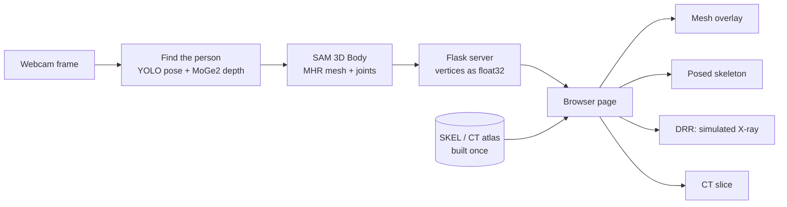
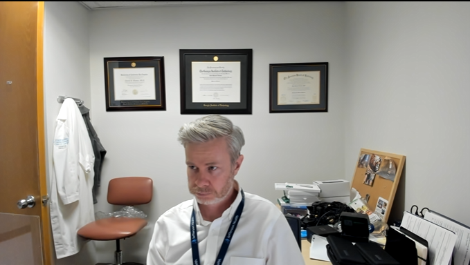
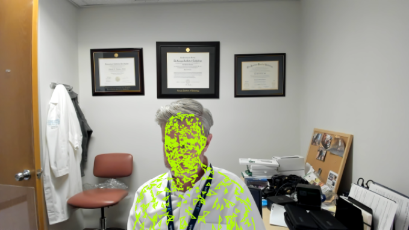
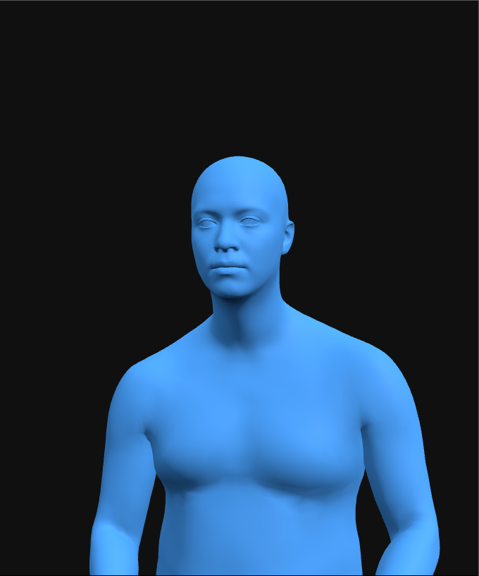
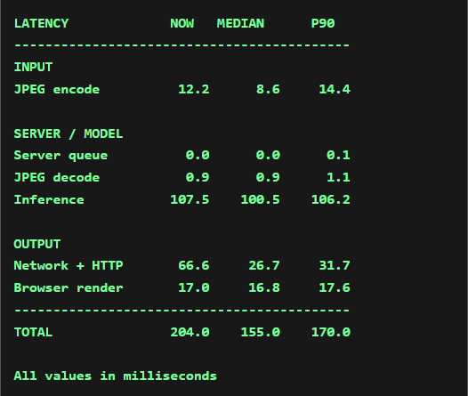
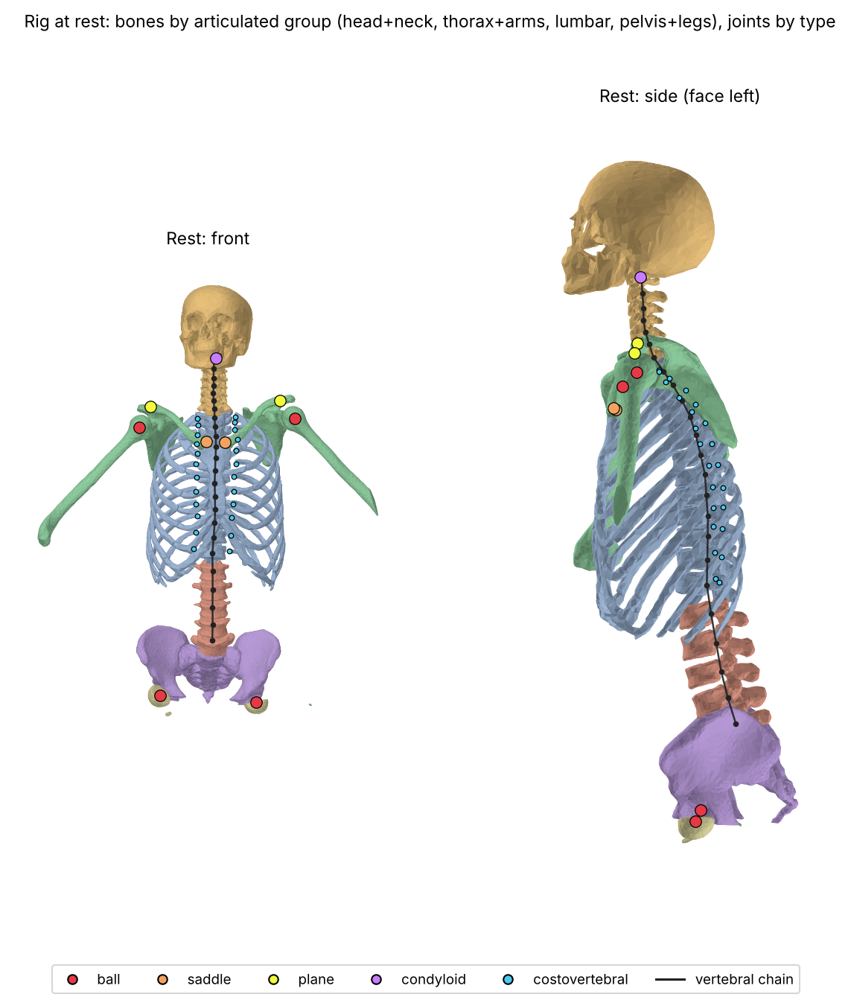
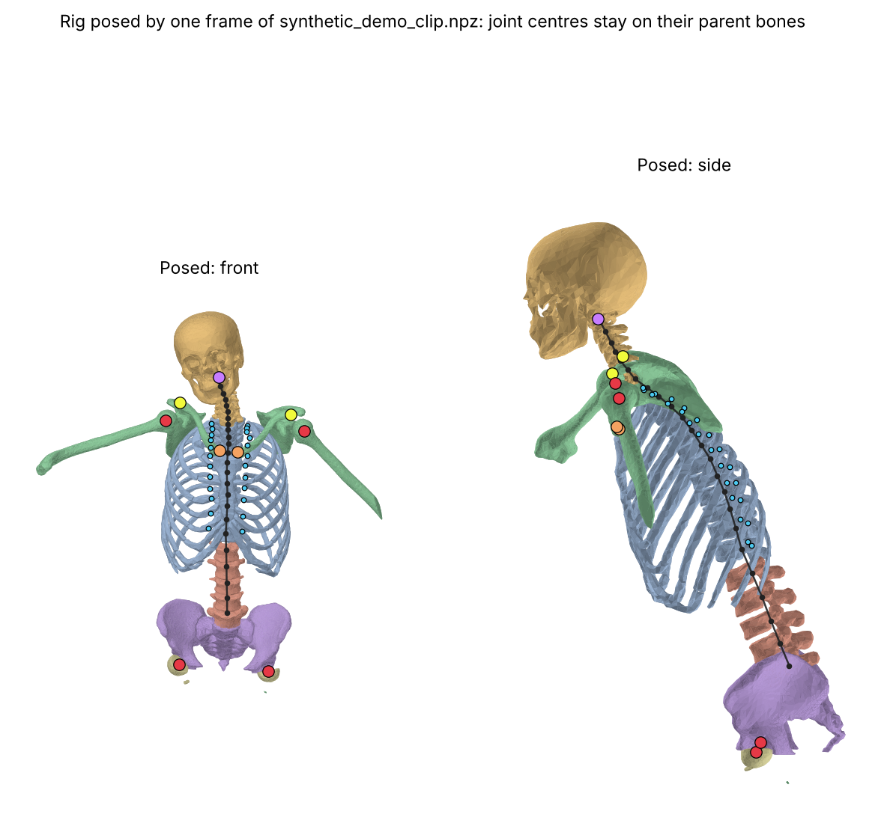
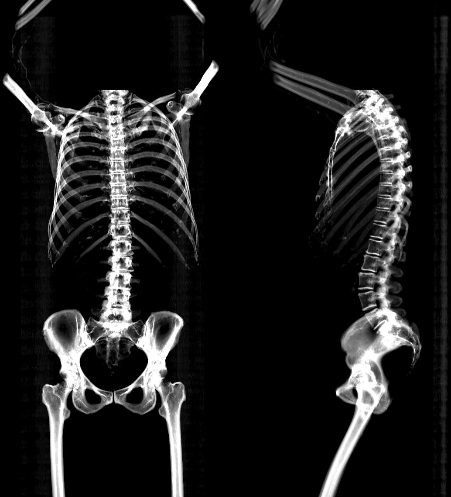
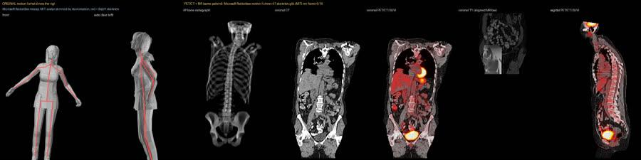

# Webcam to anatomy: the pipeline in pictures

A webcam frame goes in. A 3-D body mesh comes out, with a skeleton, a simulated X-ray and a CT view that follow the person's pose.



Everything left of the browser runs live, on every frame. The atlas on the bottom row is built once and read from disk.

---

## 1. Webcam frame

The browser sends each frame as a JPEG over a WebSocket to the local server (port 8097).



## 2. Find the person

A YOLO11 pose detector boxes the person and keeps following the same one. MoGe2 estimates camera field of view and depth, so the mesh gets the right size and distance. The server prints `FOCAL_CALIBRATED` once the focal length has settled.



## 3. Fit a body mesh

Fast SAM 3D Body predicts pose and shape and returns a mesh in the MHR format (18,439 vertices, 36,874 faces) plus a joint skeleton. The server streams the vertices to the page as raw float32 bytes.



The panel on the left of the page shows where time goes for each frame:



## 4. Put bones inside the mesh

The MHR mesh has no bones. The page adds them from an atlas: bone meshes bound to the MHR joints. When the joints move, the bones move with them.

Two sources of bones exist:

- **CT atlas bones**: the default, and the bones shown below.
- **SKEL**: a learned whole-body skeleton (hands, feet and jaw included). It is built once with `tools/fit_skel_to_mhr.py` and `tools/build_skel_atlas.py`, and its files are not in git (licence). When `atlas/skel.*` is present, SKEL is the default skeleton.

The figures below show the CT atlas bones. They're checked-in figures from the repo, drawn from a synthetic test clip. They are not the live page, and they are not SKEL.

At rest, with joint types marked:



Posed by one frame of motion (joint centres stay on their parent bones):



## 5. Simulated X-ray (DRR)

A digitally reconstructed radiograph adds up bone density along each ray. The page can make one from the bone surfaces, or from the CT voxels when `ct_volume.*` is present. The image below is a sample whole-body CT rendered this way, front and side.



## 6. Several views of the same pose

One motion drives the rig. The strip shows, left to right, the driving figure, an AP bone radiograph, a coronal CT, a coronal PET-CT, a coronal MR and a sagittal PET-CT.



---

## What each data file adds

| Present | The page shows |
|---|---|
| Code only | Body mesh, CT-atlas bones, surface DRR, label slice |
| + `atlas/skel.*` | SKEL skeleton (default) |
| + `ct_volume.*` | Real CT slice and CT-voxel DRR |
| + `ct_pet.*` | PET checkbox |

## One-time SKEL build

```text
make_mhr_rest.py      model.ckpt + mhr_model.pt        -> mhr_rest.npz            neutral MHR body
fit_skel_to_mhr.py    mhr_rest.npz + SKEL model        -> skel_fit_mhr_rest.npz   SKEL fitted to that body
build_skel_atlas.py   skel_fit_mhr_rest.npz + MHR      -> skel.json + skel.bin    what the page loads
```

The skeleton is generic. It is fitted to the average MHR body, not to a CT and not to the person on camera. The person's live pose moves it through the MHR joints. Setup details are in [INSTALL.md](../INSTALL.md).
