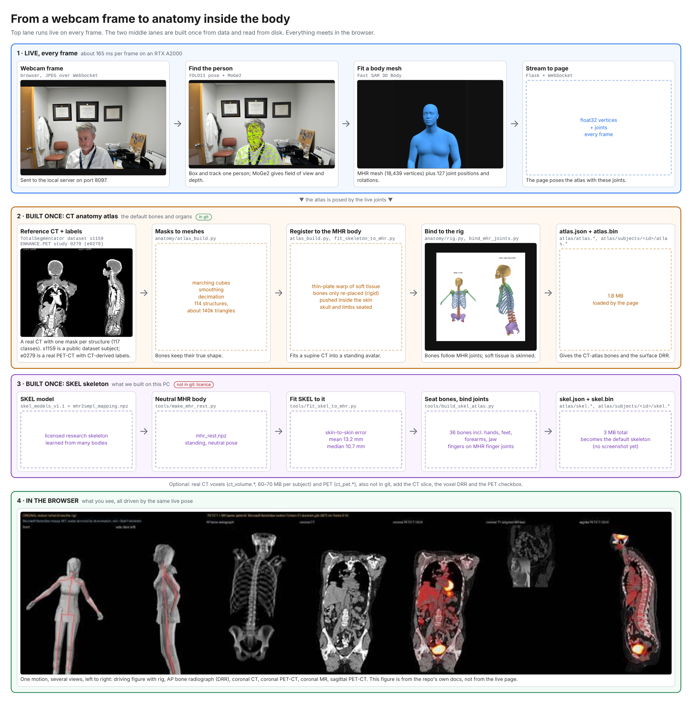

# Webcam to anatomy: the pipeline in one picture

The top lane runs live on every frame. The CT and SKEL lanes are built once from data and read from disk. They all meet in the browser.

## Where the TotalSegmentator anatomy comes from

It is not predicted from the webcam. It is a real CT scan that was segmented once, turned into meshes, and fitted into the MHR body.

1. **A reference CT with one mask per structure.** Two subjects are built. `e0279` is the default: a real head-to-toe PET-CT (ENHANCE.PET study 0279, CC BY-NC 4.0) whose CT-derived labels ship with the dataset, converted by `tools/enhance_subject.py`. No segmentation model is run. `s1159` is a subject of the public TotalSegmentator dataset (Zenodo 10047292, CC BY 4.0, head to upper thigh) with its ground-truth 117-class masks. Your own CT would work too if you run TotalSegmentator on it first.
2. **Masks to meshes** (`anatomy/atlas_build.py`): marching cubes, smoothing, decimation. The result is 114 structures and about 140k triangles.
3. **Fit into the MHR body.** The CT skin is registered to the neutral MHR mesh. Soft tissue is warped. Bones are never warped, only re-placed rigidly so their shapes stay true. Everything is then pushed inside the skin, and the skull and limbs are seated (`tools/fit_skeleton_to_mhr.py`).
4. **Bind to the rig** (`anatomy/rig.py`, `tools/bind_mhr_joints.py`): bones follow MHR joints and soft tissue is skinned. The output is `atlas/atlas.json` and `atlas/atlas.bin` (1.8 MB). They are in git.

Reference-subject fetch: `python tools/fetch_ts_subject.py s1159 OUT_DIR` downloads one subject without the 23.6 GB archive.

## Two skeletons, one page

| | CT atlas bones | SKEL |
|---|---|---|
| Source | One real person's CT | A learned model of many bodies |
| Covers | Trunk, skull, shoulder girdle, humeri, femora | Whole body incl. hands, feet, forearms, jaw (36 bones) |
| Sized to | The CT subject, then re-fitted to MHR | The average MHR body (13 mm mean fit error) |
| In git | yes | no (licence) |
| Default in the page | when SKEL is absent | when `atlas/skel.*` is present |

## What each data file adds

| Present | The page shows |
|---|---|
| Code only | Body mesh, CT-atlas bones, surface DRR, label slice |
| + `atlas/skel.*` | SKEL skeleton (default) |
| + `ct_volume.*` | Real CT slice and CT-voxel DRR |
| + `ct_pet.*` | PET checkbox |

Setup details are in [INSTALL.md](../INSTALL.md).
